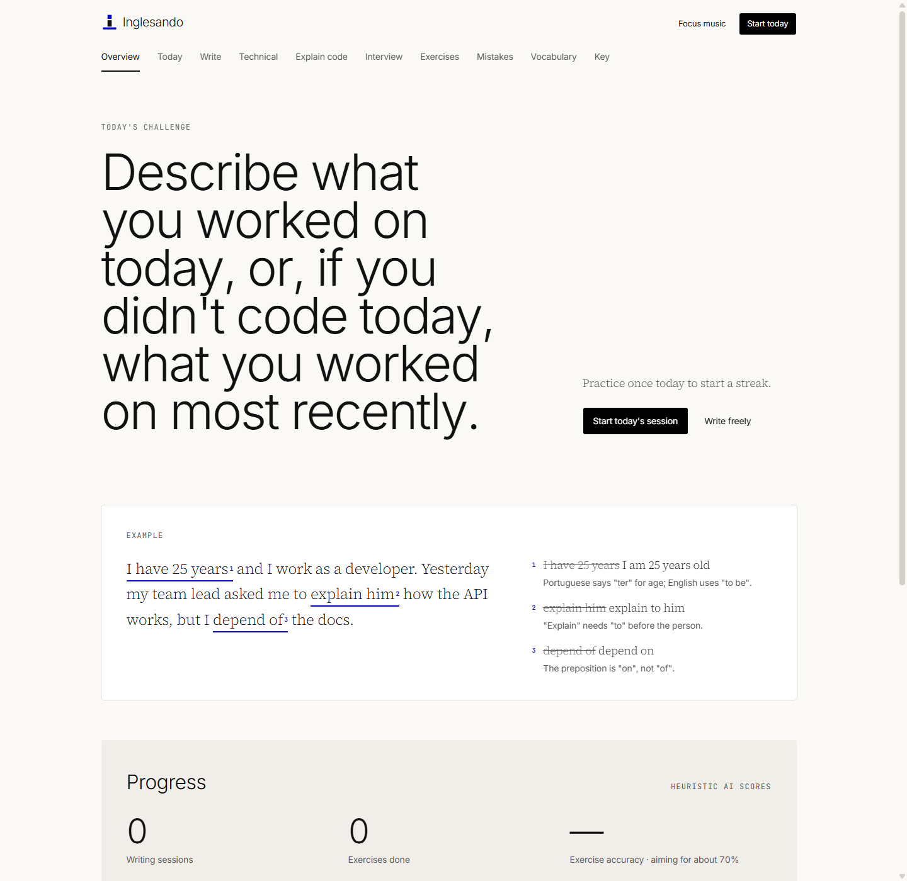
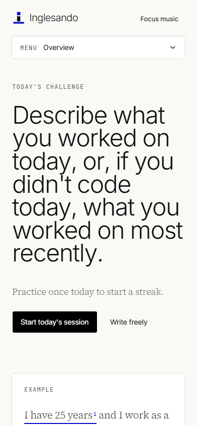
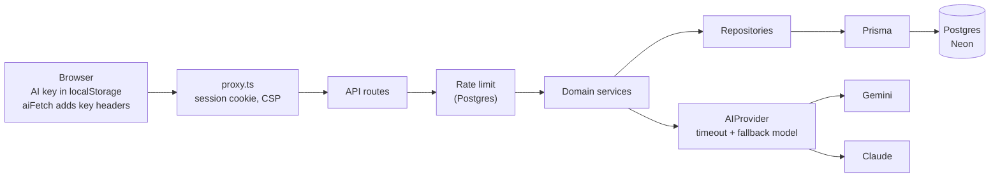

# Inglesando

An AI English coach for Brazilian developers who read English well and want to write it better:
PR descriptions, issues, code reviews, interview answers. You write, it proofreads, and it turns
your recurring mistakes into practice. Explanations are in English, with Portuguese where it
clarifies why a literal translation fails.

**Live: <https://inglesando.vercel.app>** (no login; bring your own AI key, see [Try it](#try-it))

[](https://github.com/levyrodrigues23/inglesando/actions/workflows/ci.yml)
[](./LICENSE)

<p>
  
  
</p>

## Try it

1. Create a free Google Gemini key at <https://aistudio.google.com/apikey>.
2. Open <https://inglesando.vercel.app/settings>, paste the key, and test it.
3. Go to `/write` and write something.

Your key stays in your browser (see [Privacy](#privacy)). Anthropic keys work too. A free
Gemini key is convenient, but Google may use prompts sent through free-tier keys to improve its
products, so do not write anything confidential with one.

## The mistake loop

1. **Write first.** Free writing, a daily challenge, a Technical English prompt, a code
   explanation, or an interview answer. There is no "fix my text" button without writing.
2. **Get a proofed page.** The model separates *incorrect* from *correct but unnatural* from
   *natural*, marks each mistake inline, and explains it. Your original intent is preserved;
   the natural version is offered as a separate alternative.
3. **Mistakes become patterns.** A recurring error collapses into one pattern with frequency,
   category and mastery, not one row per typo.
4. **Patterns become exercises.** Multiple choice, fill-in-the-blank, rewrite and translation
   exercises are generated from your own weak patterns, with answer-before-reveal recall.
   Grading is deterministic; the AI is not called to grade.
5. **Progress is shown honestly.** Scores are heuristic model signals, not CEFR levels.

Also: a dashboard with streak, vocabulary, interview practice, and Explain Code (pasted code is
context only and is never stored).

## Privacy

There is no login and no email. The app issues each browser an anonymous signed cookie; your
data hangs off that random id.

- **Bring your own key.** You paste a Google Gemini or Anthropic key on `/settings`. It lives
  in your browser's `localStorage` and is sent only in request headers to this app's own
  routes, which forward it to the provider for that one request. The server never stores,
  logs, or puts it in a URL or in analytics, and in production it never falls back to a
  server-side key.
- **You can delete everything** from the app (`DELETE /api/me`), and accounts idle for 90 days
  are removed by a daily cron job.
- Rate limits are kept in Postgres, keyed by user id and a salted hash of the IP, never the
  raw IP.

The full text, in English and Portuguese, is on the `/privacy` page. Reporting a
vulnerability: see [`SECURITY.md`](./SECURITY.md).

## Run it locally

Requires Node.js 22+, pnpm (`corepack enable`), and Docker (for Postgres).

```bash
pnpm install                 # also runs `prisma generate`
cp .env.example .env         # then generate SESSION_SECRET, IP_HASH_SALT, CRON_SECRET
docker compose up -d         # Postgres on 127.0.0.1:5432
pnpm db:deploy               # apply migrations
pnpm dev                     # http://localhost:3000
```

For AI you have two options: open `/settings` and paste a key (the same flow as production),
or set `AI_PROVIDER` plus `GEMINI_API_KEY` or `ANTHROPIC_API_KEY` in `.env`. Those server-side
variables are for local development only and are ignored in production. A free Gemini key is
available at <https://aistudio.google.com/apikey>.

Tests never need an AI key (the provider is mocked) but do need Postgres:

```bash
pnpm db:test:prepare         # creates english_coach_test and migrates it
pnpm check                   # typecheck + lint + tests, what CI runs (CI also builds)
```

All variables are documented in [`.env.example`](./.env.example). Use `127.0.0.1`, not
`localhost`, in the database URLs.

## How it works



Routes are thin; business logic lives in domain services, and every AI response is validated
with a Zod schema before it is stored. Stack: Next.js 16, React 19, TypeScript, Tailwind CSS 4
with shadcn/ui, PostgreSQL, Prisma 7, Zod 4, Vitest, pnpm.

## Contributing

Read [`CONTRIBUTING.md`](./CONTRIBUTING.md) first (branch from `develop`, CI must be green; some
dependency versions are pinned on purpose). Product spec: [`SPEC.md`](./SPEC.md). Security
reports: [`SECURITY.md`](./SECURITY.md). Licensed under [MIT](./LICENSE).
